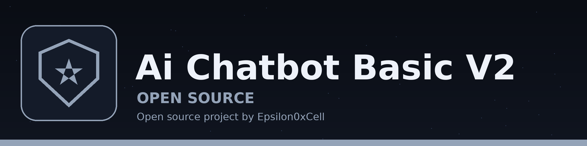

# AI Chatbot Basic V2

A small ChatterBot based chatbot named Jordan, built around a home storyline with an identity check at startup. Version 2 is the more developed entry point: `main-v2.py` follows the storyline more completely than `main.py`.

## How it works

Both entry points do the same basic steps, using the helpers in `functions.py`:

1. Create the bot with `create_bot("Jordan")`. The bot uses the `BestMatch` logic adapter and SQL storage, and `read_only` is False, so it learns from the conversations it has. Training and chat history are stored in a local SQLite database file created in the folder you run it from.
2. Train on the full English ChatterBot corpus with `train_all_data`.
3. Ask `State your identity please:` and check the answer exactly as typed:
   - `Mark`: welcomed home.
   - `Jane`: welcomed, and told Mark is out.
   - Anything else: `Your access is denied here.` and the program exits.
4. Train custom storyline data with `custom_train` (see the difference between the two entry points below).
5. Start the chat loop with `start_chatbot`. Type `bye`, `bye jordan`, or `good bye` to leave. Closing the input or pressing Ctrl-C also ends the chat cleanly with the same goodbye message.

## The two entry points

- `main-v2.py`: Trains one shared custom answer (who owns the house) for every accepted identity. Mark's personal answers (where he was born, his favourite book, movie, and sport) are trained only when the identity is Mark.
- `main.py`: The earlier version. It pauses for 3 seconds after the identity check. It now follows the same rule as `main-v2.py`: the house owner answer is trained for every accepted identity, and the personal answers are trained only for Mark. Its personal answers are different jokes and choices from the ones in `main-v2.py`, because the two files were written as separate drafts of the storyline.

## Requirements and setup

Verified on Python 3.12 with ChatterBot 1.2.11.

```bash
pip install -r requirements.txt
python -m spacy download en_core_web_sm
```

`requirements.txt` installs ChatterBot, the separate `chatterbot-corpus` package that supplies the English corpus data, and PyYAML, which ChatterBot needs to read the corpus files. The spaCy model download is a separate step: without it, creating the bot fails with a ChatterBot setup error saying the model for English is missing.

## Run it

```bash
python main-v2.py
```

or the earlier version:

```bash
python main.py
```

Verified behaviour: as Mark, asking `Who is the owner of this house?` gets the trained custom answer, and `bye` ends the chat with `Jordan: Good bye and have a blessed day!`. An unknown identity is denied and the program exits before any chat starts. Corpus training runs on every start, so startup takes a while.

## About the training-data folder

The `training-data/` folder holds copies of English corpus YAML files (ai, greetings, humor, and so on). No code in this repo reads that folder: `train_all_data` trains `chatterbot.corpus.english` from the installed `chatterbot-corpus` package, whose files these copies match. The folder is kept as a local reference copy, and `training-data/training-data.md` just describes it as the training data for the bot. Editing those local files will not change what the bot learns.
